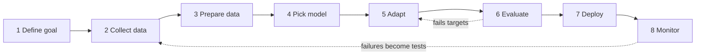
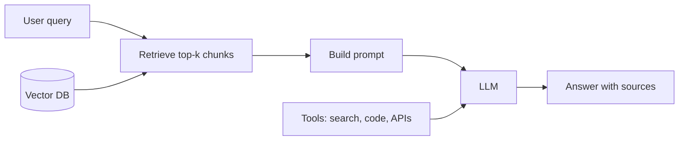
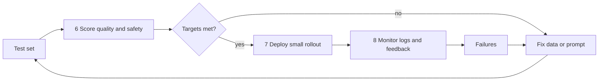

# LLM project workflow

Eight modules from idea to production. Evaluation and monitoring loop back into the earlier steps, so the system improves over time.

## Modules 1-3: data side

```mermaid
flowchart LR
    subgraph M1[1 Define goal]
        a1[Users and use case]
        a2[Success metrics]
        a3[Cost and latency cap]
        a4[50 test examples]
    end
    subgraph M2[2 Collect data]
        b1[PDFs, web, DB, logs]
        b2[Check license and privacy]
        b3[Remove personal data]
        b4[Record each source]
    end
    subgraph M3[3 Prepare data]
        c1[Extract and clean]
        c2[Deduplicate]
        c3[Chunk 300-800 tokens]
        c4[Embed into vector DB]
    end
    M1 --> M2 --> M3
```

## Modules 4-5: runtime pipeline

Adaptation order (cheapest first): prompt engineering, then RAG, then fine-tuning (LoRA/QLoRA), then tools or agents.

## Modules 6-8: quality gate and feedback loop

## Module notes

| # | Module | Key outputs | Common pitfall |
|---|--------|-------------|----------------|
| 1 | Define goal | One-page spec, 30-50 test examples | Vague goals make evaluation impossible |
| 2 | Collect data | Licensed, cleaned sources with provenance | Outdated data gives confident wrong answers |
| 3 | Prepare data | Chunks, embeddings, vector store (or train/val/test splits) | Bad chunking is the top cause of weak RAG |
| 4 | Pick model | API or open-source choice backed by test-set scores | Over-sizing the model before proving the idea |
| 5 | Adapt | Working pipeline: retrieve, prompt, generate, post-process | Fine-tuning to add facts instead of style or format |
| 6 | Evaluate | Scores for accuracy, faithfulness, latency, cost; safety checks | Shipping without a held-out test set |
| 7 | Deploy | API, guardrails, caching, rate limits, small rollout | Keys in code; no fallback on model errors |
| 8 | Monitor | Logs, feedback, drift alerts, new test cases | No loop from failures back into data and tests |
